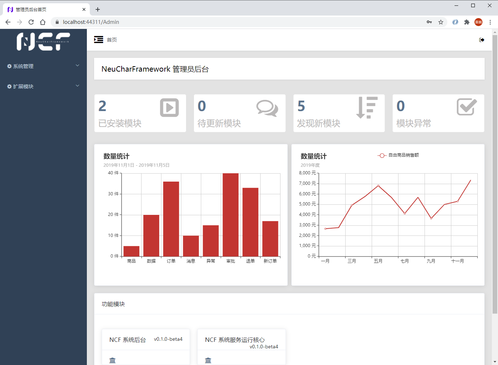
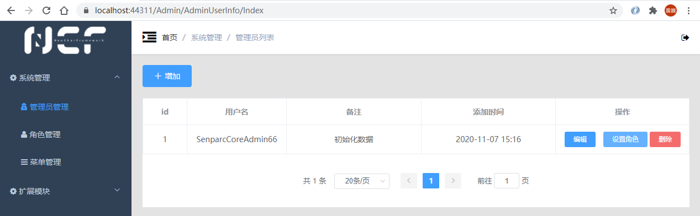
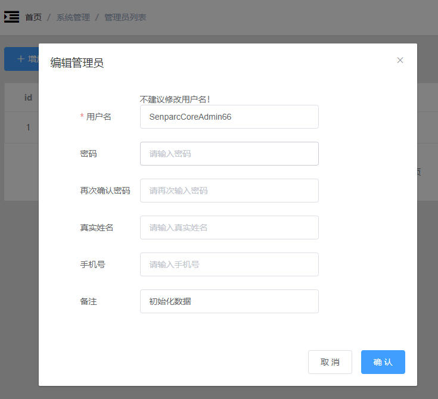
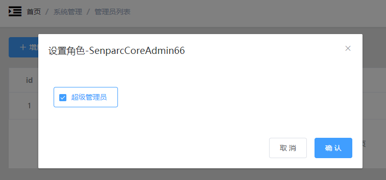
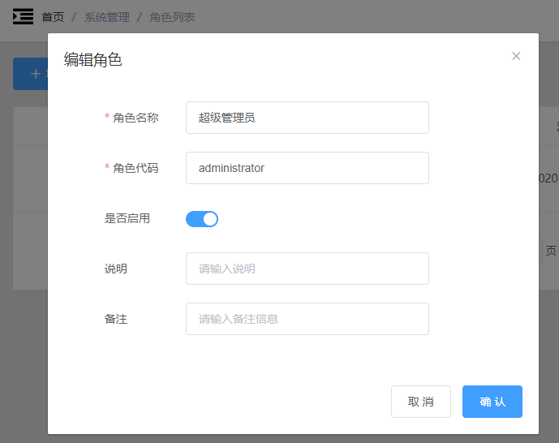
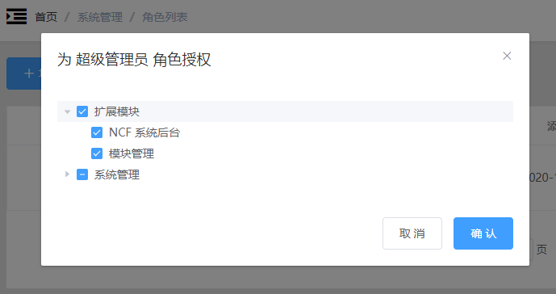
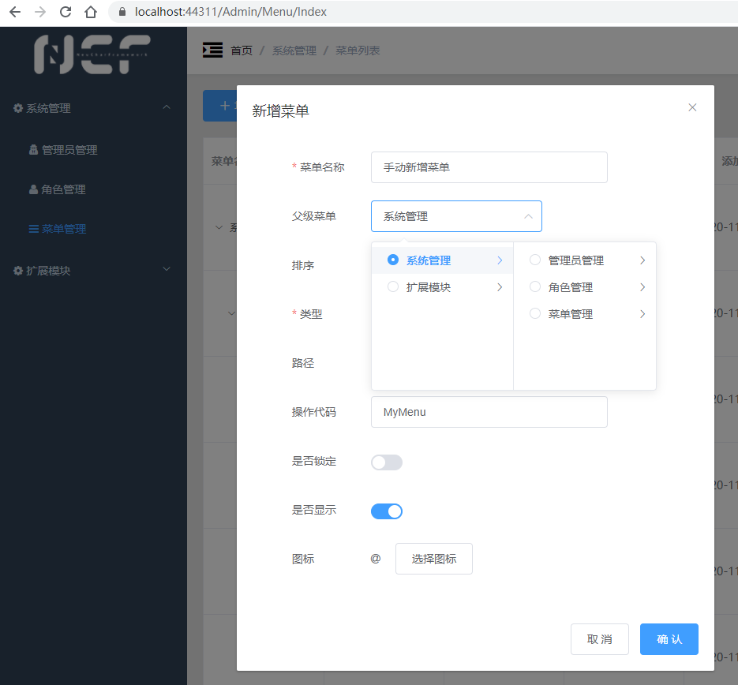
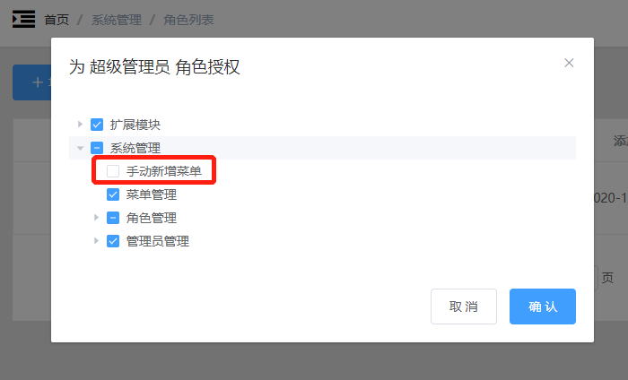
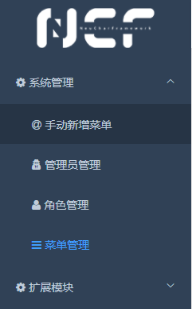
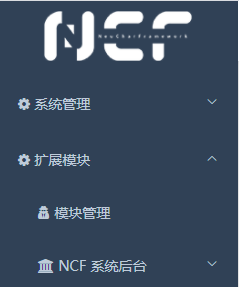

# Admin Backend

After successful login, you can enter the admin backend.

## Admin home

Home combines module status, Agents status, Host monitoring, the AI chat entry and configured NeuCharPivot boards.
Module counters lead to installation/update management. **Manage Agents** and **Manage boards** open their respective pages,
not start tasks. **Open quick chat** opens the conversation UI; a model request begins when a message is sent.
See **Host resource monitor** below for chart units and time ranges, or [Admin basics](./admin-background.html)
for system navigation and administrator accounts.

## Host resource monitor

The home panel combines live Host/Web-process metrics and historical trends.
Choose a time range, zoom to inspect an interval, and return to live tracking
when finished. CPU and memory use the percentage axis; network throughput uses
Mbps. A similarity in chart shapes is not evidence that metrics share a unit.
History is cache-backed and bounded: an empty interval can mean no retained
samples, not zero utilization.

## Administrators

Use **Administrator management** to create or edit an administrator, then assign
roles. Check the target username before resetting credentials or changing role
membership. An administrator account is not the same as an Accounts-module user
or a Weixin follower. Do not copy passwords into documentation, chat, or logs.

## Roles and permissions

Create a role, configure its permission tree, and assign it to the intended
administrators. Save each stage and verify access with the affected account.
A visible menu alone does not grant API or Function access. If access is denied,
check role membership, permission codes, module availability, and any separate
NeuCharPivot policy before broadening permissions.

## Menus

Use menu management to maintain navigation, parent-child relationships, and
target addresses. Verify the destination after saving. Hiding an entry is not
an authorization boundary; the destination still needs server-side permission
checks. Module-provided navigation should remain consistent with module state.
**Configuration mode** adjusts navigation layout/order and requires saving the configuration.
The regular editor's type, path, operation code, lock and visibility fields serve different purposes.
New menus still require role authorization; they are not automatically visible to every administrator.

## Homepage

The admin backend homepage contains statistical information of various modules, including `Installed Modules`, `Modules to be Updated`, `Newly Discovered Modules`, `Abnormal Modules`, etc.

## Module Status

The meanings of each module status are as follows:

| Status           | Description                                                                    |
| ---------------- | ------------------------------------------------------------------------------ |
| Installed        | XNCF modules that have been installed                                          |
| To be Updated    | XNCF modules that have been installed and a new version is found               |
| Newly Discovered | XNCF modules whose dll files have been scanned but not installed in the system |
| Abnormal         | XNCF modules with abnormalities, such as installed but dll not found           |

## System Management Menu

In the left menu, expand [System Management], you can see the default 3 menus: Admin Management, Role Management, Menu Management. Among them:

- `Admin Management` is used to assign admin accounts, passwords, and roles that can log in to the admin backend

- `Role Management` is used to set roles with different permission combinations, and different roles can be assigned to different admins

- `Menu Management` can be used to manually manage the items in the left menu, and also includes control over page and button permissions, supporting multi-level menus.
  > Tip: The function of "Menu Management" not only covers the control of the left menu but also allows defining pages and buttons. These pages and buttons can be precisely controlled by roles in "Role Management".

For example, we can manually add a menu, define the name, parent menu, page path, and other information:

After saving, we are surprised to find: the left menu has not changed? Don't rush to say WTF, let's turn to "Role Management", open the permissions of "Super Admin", the truth is here:

For security reasons, all manually added elements will not be automatically added to the permissions. When we select the new menu and confirm to save, we can see the newly added [Manually Added Menu]:

## Extension Module Menu

The `Extension Module` menu is used to manage all modules (XNCF).

Among them, `Module Management` is a system page. In addition to this, all other menus appear automatically in the menu after the module is installed, such as the already installed module: `NCF System Backend`, which is the currently running backend (the backend is also a module).

> Tip: Due to the highly modular architecture of NCF, most of the functions of the entire site run on modules, using module management modules, running modules based on modules, and generating modules with modules.

## Best Practices

The Admin backend is a very sensitive system. Whether you keep the original path (`/Admin/Login`) or modify the path, as long as it appears on the public network, it may be exploited by hackers. Therefore, we recommend that you:

1. Try not to expose the Admin backend in public places or unsafe network environments
1. If you must expose it, it is recommended to use a combination of: modifying the default `/Admin/Login` path, using an IP whitelist, limiting access times, using captcha, etc. to protect the backend
1. Regularly update the system to fix vulnerabilities in time (NCF provides very convenient modular update capabilities, and the NCF base is also very clean, which can be quickly covered from the template, but please also do the necessary checks)
1. Regularly back up data to prevent data loss
1. Use secure passwords, do not use simple passwords
1. Do not save passwords directly in the browser
1. Do not arbitrarily grant Admin backend permissions to others
1. Do not arbitrarily grant Admin backend permissions to unfamiliar modules
