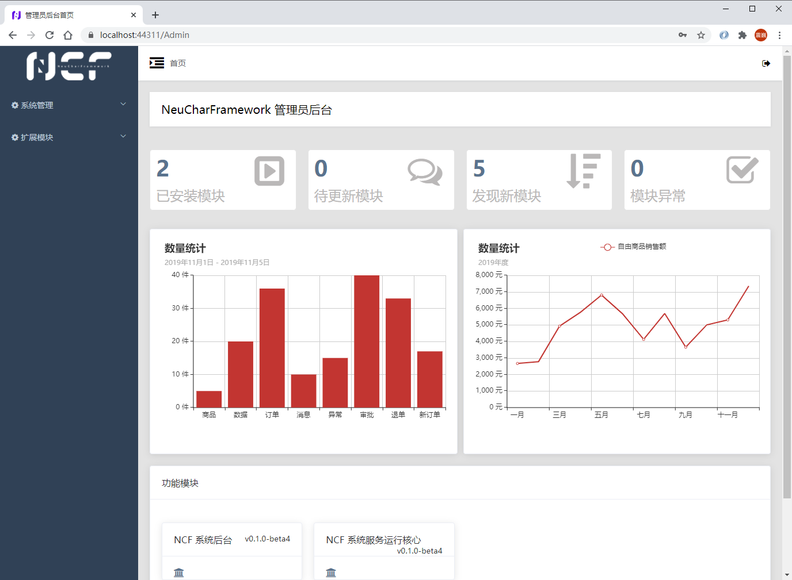
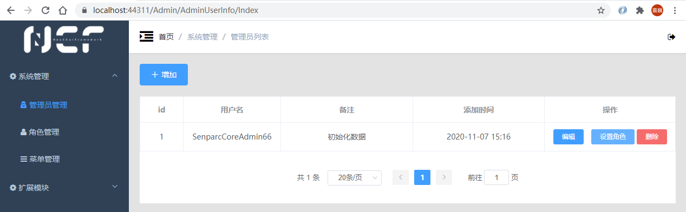
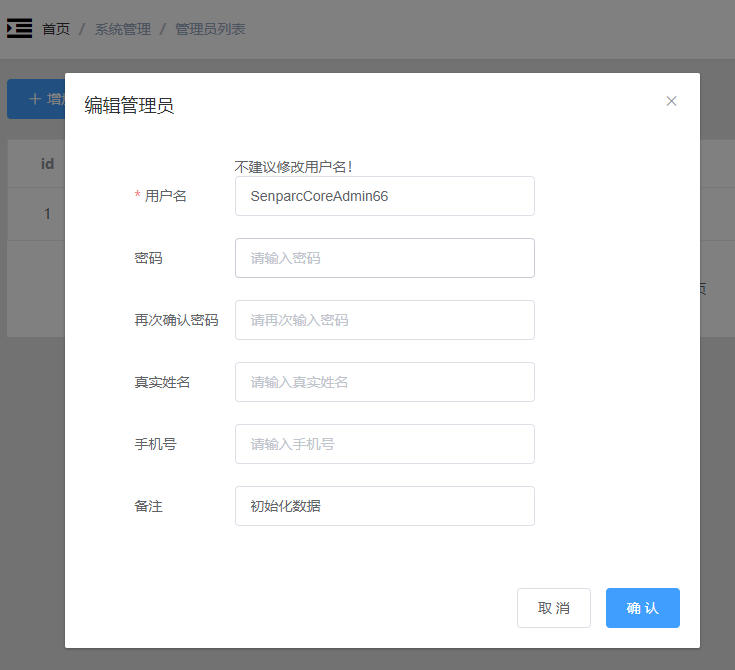
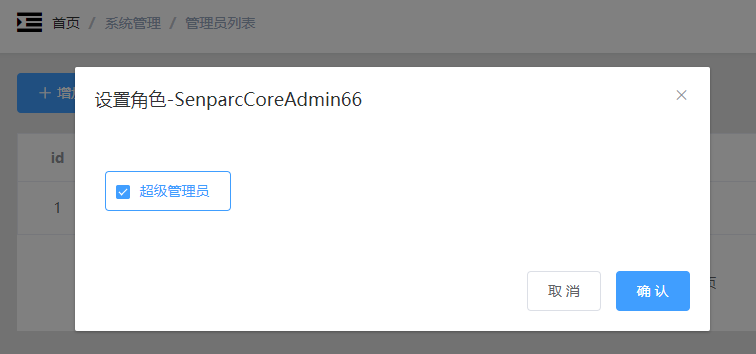
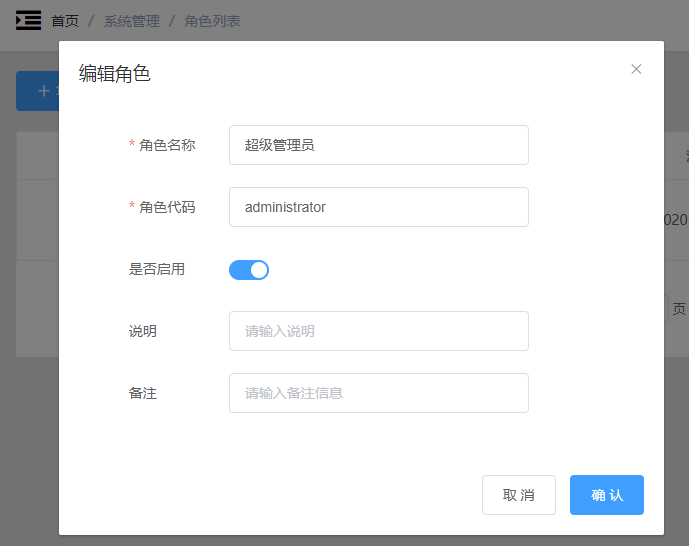
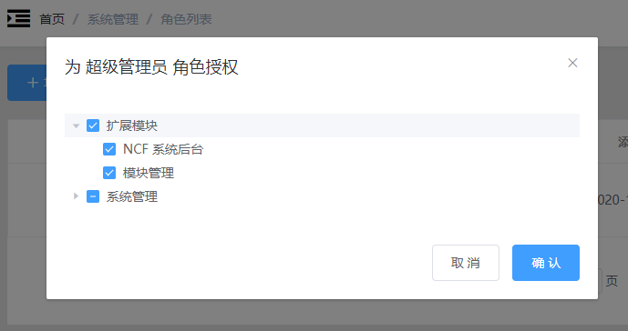
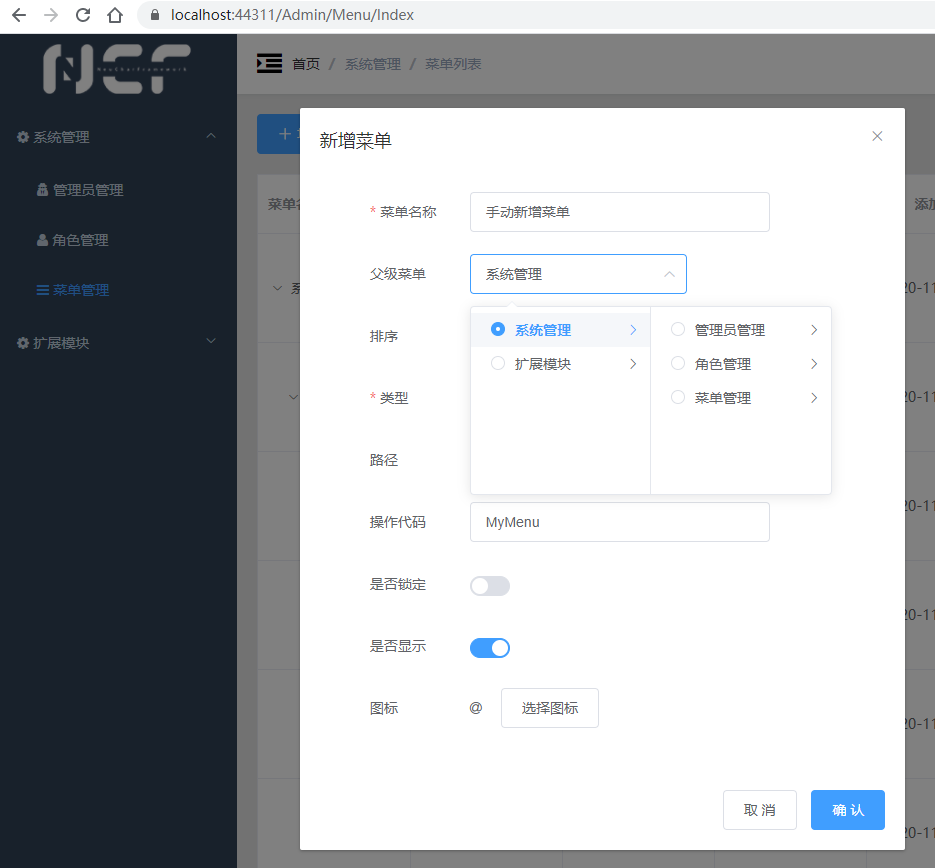
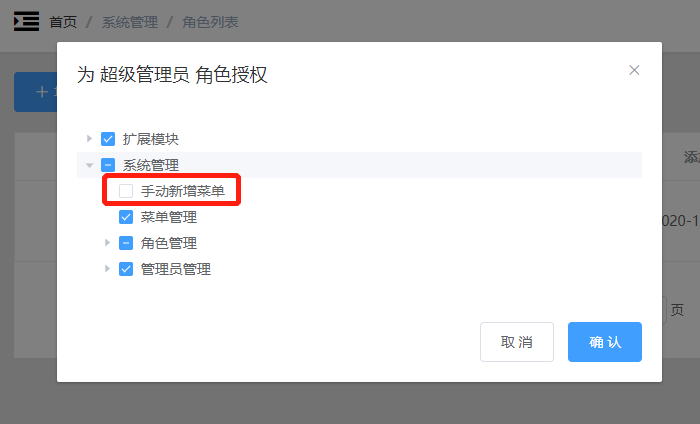
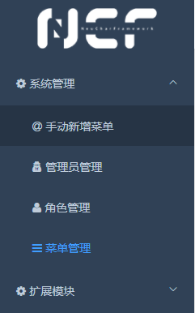
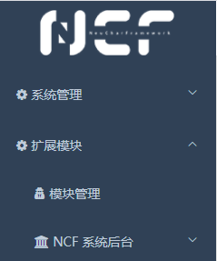

# 管理员后台

登录成功后，即可进入到管理员后台。

## 后台首页

首页汇总模块状态、Agents 状态、Host 资源监控、AI 智能助手入口及已配置的 NeuCharPivot 面板。
模块统计入口用于继续安装、更新或管理模块；“管理 Agents”“管理面板”分别进入对应管理页，
不是启动任务的按钮。“打开快捷对话”打开聊天入口，实际发送消息后才开始请求模型。
资源曲线的单位、时间范围和缩放见本页“Host 资源监控”；系统菜单与后台账号见
[管理员后台入门](./admin-background.html)。

## Host 资源监控

首页面板整合 Host/Web 进程的实时指标和历史趋势。选择时间范围、缩放查看区间，
分析后可回到实时跟随。CPU、内存使用百分比轴，网络吞吐量使用 Mbps 轴；
曲线相似不代表指标单位相同。
历史记录保存在有容量及时间边界的缓存中，空白区间可能是没有保留采样，不表示利用率为零。

## 管理员

在“管理员管理”中创建或编辑管理员，然后授予对应角色。
重置凭据或调整角色前核对目标用户名。管理员账号不同于 Accounts 模块的业务用户，
也不同于微信关注用户。不要把密码粘贴到文档、聊天或日志中。

## 角色与权限

先创建角色，再设置权限树，并将角色授予目标管理员；分别保存后，用受影响的账号验证。
能看到菜单不等于拥有 API 或 Function 权限。遇到拒绝访问时，先检查角色归属、
权限码、模块是否可用，以及独立的 NeuCharPivot 策略，不要直接扩大授权范围。

## 菜单

菜单管理用于维护导航、父子层级及目标地址。保存后验证实际跳转。
“配置模式”用于调整菜单布局/排序，调整后需保存配置；普通编辑窗中的类型、路径、操作代码、
锁定和显示开关是不同字段。新增菜单后还需在角色权限中授权，不会自动让所有管理员可见。
隐藏菜单不是权限隔离，目标页面仍须服务端鉴权。
模块提供的导航应与模块开启状态保持一致。

## 首页

管理员后台首页，包含了各类模块的统计信息，包括`已安装模块`、`待更新模块`、`新发现模块`、`异常模块`等。

## 模块状态

各模块状态含义如下：

| 状态   | 说明                                                        |
| ------ | ----------------------------------------------------------- |
| 已安装 | 已经完成安装的 XNCF 模块                                    |
| 待更新 | 已经完成安装，并且发现了新版本的 XNCF 模块                  |
| 新发现 | 已经扫描到模块的 dll 文件，但是并没有安装到系统的 XNCF 模块 |
| 异常   | 出现异常的 XNCF 模块，例如已经完成安装，但是 dll 未找到     |

## 系统管理菜单

左侧菜单中，展开【系统管理】，可以看到默认的 3 个菜单：管理员管理、角色管理、菜单管理。其中：

- `管理员管理` 用于分配可登录管理员后台的管理员账号、密码及角色

- `角色管理` 用于设置具备不同权限组合的角色，不同的角色可以赋予不同的管理员

- `菜单管理` 可用于手动管理左侧菜单的条目，同时也包括对页面和按钮权限的控制，支持多级菜单。
  > 提示：“菜单管理”的功能除了涵盖对左侧菜单的控制以外，也可以定义页面和按钮，这些页面和按钮，可以在“角色管理”中被角色精确管控。

例如，我们可以手动新增一个菜单，定义名称、父级菜单、页面路径等信息：

完成保存后，我们惊奇地发现：左侧菜单并没有变化？不要急着说 WTF，我们转到“角色管理”，打开“超级管理员”的权限，真相就在这里：

出于安全考虑，手动新增的所有元素不会自动添加到权限中，当我们选中新菜单，并确认保存后，即可看到新增的【手动新增菜单】：

## 扩展模块菜单

`扩展模块` 菜单用于管理所有的模块（XNCF）。

其中，`模块管理` 是系统页面，除此以外的菜单都是安装完模块之后，自动在菜单中出现的，如已经more安装好的模块：`NCF 系统后台`，就是正在运行的这个后台（后台也是一个模块）。

> 提示：由于 NCF 高度模块化的架构，整个站点的绝大多数功能都运行在模块上，使用模块管理模块、基于模块运行模块、用模块生成模块。

## 最佳实践

Admin 后台是一个非常敏感的系统，无论您保留了原始的路径（`/Admin/Login`）或者修改了路径，只要出现在公网上，都有可能被黑客利用。因此，我们建议您：

1. 尽量不要在公共场所或不安全的网络环境中暴露 Admin 后台
1. 如果必须暴露，建议综合使用：修改默认的 `/Admin/Login` 路径、使用 IP 白名单、限制访问次数、使用验证码等方式保护后台
1. 定期更新系统，及时修复漏洞（NCF 提供了非常便捷的模块化更新能力，NCF 的基座也非常干净，可以快速从模板进行覆盖，当然也请做好必要检查）
1. 定期备份数据，以防数据丢失
1. 使用安全的密码，不要使用简单密码
1. 不要将密码直接保存在浏览器中
1. 不要随意将 Admin 后台的权限赋予他人
1. 不要随意将 Admin 后台的权限赋予不熟悉的模块
